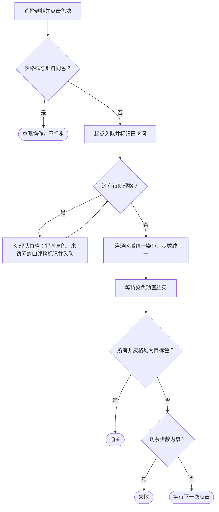

# 溢彩画 · ColorfulPainting

《鸣潮》溢彩画的网页复刻。

[在线体验](https://overflowing-palette.vercel.app/)

## 实现流程

核心是四邻域洪水填充（Flood Fill），使用广度优先搜索（BFS）确定本次染色的连通区域。



设棋盘共有 N 个格子，单次染色计算的最坏时间和额外空间复杂度均为 O(N)。

## 启动

需要 Node.js 20.19+ 或 22.12+。

```sh
npm install
npm run dev
```

## 构建与离线运行

```sh
npm run build
```

双击生成的 `dist/index.html` 即可离线游玩，也可通过 `npm run preview` 预览构建结果。

## 版权

《[鸣潮](https://mc.kurogames.com/main/)》相关内容与游戏资源的版权归[库洛游戏](https://www.kurogames.com/)所有。
